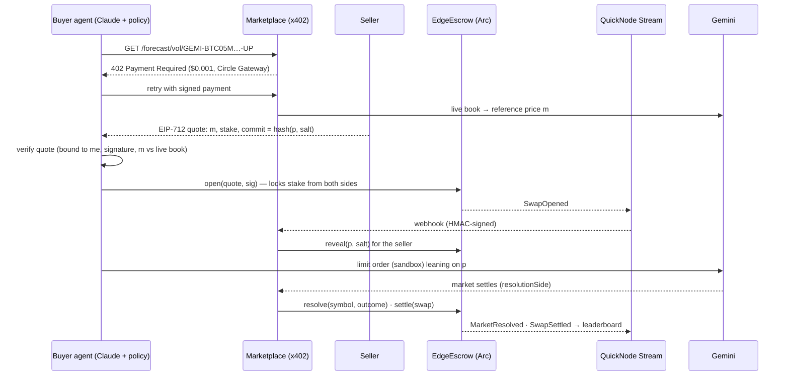
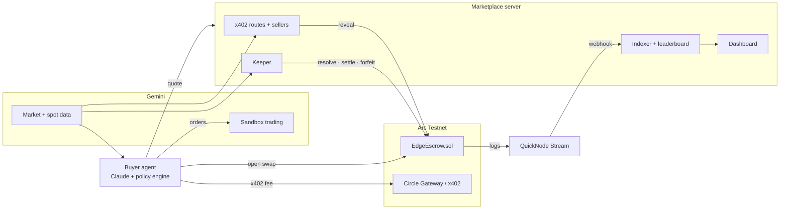

# Proof of Edge

**Pay forecasters for edge, not for data.**

AI agents buy probability forecasts for [Gemini](https://www.gemini.com/prediction-markets) prediction markets. Access is paid per request with [x402](https://x402.org) through Circle Gateway nanopayments on **Arc**, and the *quality* of every forecast is settled on-chain by an **edge swap**: once the market resolves, whoever the Brier score went against pays the other. A forecaster that knows nothing beyond the market price earns exactly zero; one that is worse than the market pays the buyer.

UBC 2026 Hackathon · **Agentic Payments and AI** · Best use of **Arc** · bounties: **Gemini Prediction Markets**, **QuickNode Streams**

| | |
|---|---|
| Escrow contract (Arc Testnet, source verified) | [`0x288a40f4aa06C0A382aA790d4b27857FcF9EF54F`](https://explorer.testnet.arc.io/address/0x288a40f4aa06C0A382aA790d4b27857FcF9EF54F) |
| USDC (Arc ERC-20 interface, 6 decimals) | `0x3600000000000000000000000000000000000000` |
| Circle Gateway Wallet (x402 settlement) | `0x0077777d7EBA4688BDeF3E311b846F25870A19B9` |
| Chain | Arc Testnet, chain ID 5042002 |

## The problem

Data APIs charge the same whether their signal is alpha or noise. In prediction markets it is mostly noise: in research before this hackathon on tens of thousands of short-horizon crypto contracts and on daily weather contracts, forecasts that looked good did not beat the market price once costs were counted. An agent paying per call for forecasts is therefore mostly paying for nothing, and it has no way to know which sellers are worth it until it has already paid.

## How it works



1. **Pay for access (x402).** Each seller sits behind an x402 paywall settled by Circle Gateway on Arc. The buyer pays $0.001 per quote gas-free from its Gateway balance, straight to the seller's address. Everything that could make a seller refuse is checked *before* the paywall, so a buyer is never charged for a refused quote.
2. **Commit, then pay for quality (edge swap).** The quote fixes the market reference `m` (the Gemini YES mid at quote time) and a hash commitment to the forecast `p`. The buyer opens the swap on Arc, which locks the same stake `k` from both sides, and only then is `p` revealed. Neither side can react to the other.
3. **Settle on the outcome.** When Gemini resolves the contract to `y ∈ {0,1}`:

   ```
   Δ = (m − y)² − (p − y)²         Brier improvement over the market, Δ ∈ [−1, 1]
   ```

   If `Δ > 0` the buyer pays the seller `k·Δ`; if `Δ < 0` the seller pays the buyer `k·|Δ|`.

### Why the mechanism is right

- **Truthful reporting is optimal.** If the true probability is `q`, the seller's expected score is `(m − p)(m + p − 2q)`, maximised exactly at `p = q`. Brier is a proper scoring rule and the payoff is linear in it.
- **No edge, no pay.** A truthful seller expects `k·(m − q)²`: zero exactly when it knows nothing the market doesn't. A seller that echoes the market nets zero on every swap.
- **Bad forecasts compensate the buyer.** A seller worse than the market pays out in expectation, so auditioning unknown sellers is cheap.
- **The buyer still profits from good forecasts.** Trading `N` contracts on an informed forecast earns about `N·|q − m|` while the forecast costs about `k·(q − m)²`, so the buyer is ahead whenever `k < N/|q − m|`.

We first designed this with a log score and a refund floor. That is *not* proper: a payout floored at zero is convex, which rewards exaggerated forecasts. Brier is bounded, so symmetric stakes cover the worst case exactly.

All three properties are fuzz-tested in Solidity ([`EdgeEscrow.t.sol`](contracts/test/EdgeEscrow.t.sol)): funds are conserved and no one moves more than one stake (2,000 runs); `E(q) − E(p) = SCALE·(p − q)²` exactly; and a truthful seller's expected score is `SCALE·(m − q)²`.

## The agent: decision loop and safety limits

The buyer agent ([`services/src/agent.ts`](services/src/agent.ts)) is a Claude (`claude-opus-5-5`) tool loop with four tools: `get_markets`, `get_sellers`, `buy_forecast`, `place_order`. **Claude proposes; a policy engine in code decides.** Every money-moving call passes through [`policy.ts`](services/src/policy.ts) first, which the model cannot see or change:

| Limit | Value |
|---|---|
| Seller allowlist | `echo`, `vol`, `overconfident` |
| Quote fee | ≤ $0.01 per quote (enforced in Circle's `onBeforePaymentCreation` hook) and ≤ $0.02 per run |
| Stake | ≤ 1 USDC per swap; ≤ 4 USDC locked across all open swaps |
| Forecasts / orders | ≤ 4 each per run |
| Trading needs edge | the bought forecast must value the outcome ≥ 0.05 above the limit price |
| Unproven sellers | orders capped at 1 contract until the seller has ≥ 5 settled swaps with a 95% CI lower bound above zero |
| Order size | ≤ $5 notional; above $2 a human must approve at the terminal (no terminal → refused) |
| Kill switch | `touch data/KILL` stops every purchase and order |
| Quote checks | bound to the buyer, valid seller signature, expected swap id, reference within 2 points of the live Gemini mid, ≥ 5 s left to open |

Every purchase, trade, refusal and the agent's reasoning are logged to `data/agent-log.jsonl` and shown on the dashboard. Policy is unit-tested ([`policy.test.ts`](services/src/policy.test.ts)).

**Trading venue.** Orders go to the Gemini **sandbox** on the same contract symbol (215 crypto contracts share symbols between production and sandbox). Sandbox books for these contracts are usually empty, so each order is also marked against the **live production book** as a paper fill. No real-money order is ever placed.

## Sellers

| Seller | Forecast | Expected result |
|---|---|---|
| `echo` | repeats the market mid | exactly zero on every swap |
| `vol` | digital-option model: `P(S_T > K) = Φ((ln(S/K) − σ²τ/2)/(σ√τ))` from live Gemini spot and 60-minute realised volatility | positive when the thin Gemini book lags spot |
| `overconfident` | pushes the market 20 points away from 50/50 | negative on average: it pays buyers |

The leaderboard (dashboard and `/api/state`) reports each seller's settled swaps, mean edge, 95% CI and net USDC.

## Use of Arc

- **Settlement layer.** `EdgeEscrow.sol` holds both stakes in USDC and settles every swap on Arc. With USDC as gas, fees are predictable and tiny: deploying cost 0.07 USDC and a full open → reveal → resolve → settle cycle costs about one cent in total.
- **x402 on Arc via Circle Gateway.** Quote fees use `@circle-fin/x402-batching`: the seller middleware accepts `eip155:5042002` through the testnet Gateway facilitator, and the buyer pays from a Gateway deposit with `GatewayClient`, so sub-cent fees are viable.
- **Arc specifics handled:** USDC through its ERC-20 interface (6 decimals, never mixed with the 18-decimal native balance); every transaction priced above Arc's 20 gwei floor; `eth_getLogs` paged in 5,000-block chunks; contract verified on the Arc explorer.

## Use of Gemini

- **Market data:** `GET /v1/prediction-markets/events` (5/15-minute BTC, ETH, SOL, XRP "Up" markets), per-contract `bestBid`/`bestAsk` and reference strike for the seller's reference price `m`, and `/v1/prediction-markets/events/{ticker}` (`resolutionSide`, ~5 s after expiry) as the oracle for settlement.
- **Spot data:** `/v1/pubticker` and `/v2/candles/{pair}/1m` feed the `vol` seller.
- **Trading (sandbox):** terms status/accept, `POST /v1/prediction-markets/order`, active orders and cancel, with HMAC-SHA384 signed payloads. Gemini order ids exceed 2^53, so they are parsed and sent back exactly (`JSON.parse` source reviver + `JSON.rawJSON`).

## Use of QuickNode Streams

| Setting | Value |
|---|---|
| Network | Arc Testnet |
| Dataset | `block_with_receipts` |
| Filter | [`services/quicknode/filter.js`](services/quicknode/filter.js): keeps only logs whose address is the EdgeEscrow contract, returns `{ logs }`, skips empty blocks |
| Destination | Webhook → `POST /streams/arc` on the marketplace, verified with HMAC-SHA256 over `nonce + timestamp + body` using the Stream's security token |

**Why:** the Stream is the event backbone. `SwapOpened` deliveries trigger the seller's reveal immediately; `ForecastRevealed`, `MarketResolved` and `SwapSettled` drive the keeper, the live swap feed and the seller leaderboard. Ingestion is idempotent (keyed by tx hash + log index), so Stream retries and re-deliveries are harmless. An RPC poll runs alongside as a safety net and for backfill.

## Architecture



One Node process (`npm run marketplace`) serves the x402 routes, the dashboard, the Stream webhook, the indexer and the keeper. The keeper settles everything without babysitting: it claims the stake when a seller misses its reveal deadline, posts Gemini outcomes as the resolver, and settles revealed swaps.

## Risk assumptions

1. **Trusted resolver.** One resolver key relays Gemini's settlement on-chain. Next step: signed attestations or several resolvers. If it disappears, `refundUnresolved` returns both stakes after 7 days.
2. **Reference-price manipulation.** Gemini books are thin, so a seller could move the mid at quote time. The buyer re-checks `m` against the live book (±2 points) and quotes expire in 30 s; a time-weighted mid is the next step.
3. **Stale reference.** Edge that only comes from the book lagging spot is real information, but the buyer must check `m` when opening (it does).
4. **Sybil sellers.** A seller could spin up many addresses and promote the lucky one; the leaderboard shows `n` and a confidence interval, and every swap is on-chain per address.
5. **Risk neutrality.** Propriety assumes risk-neutral sellers; with small bounded stakes this is a fair approximation.
6. **Testnet and sandbox only.** No real-money trades.

## Repository layout

| Path | What |
|---|---|
| `contracts/` | Foundry: `EdgeEscrow.sol`, 28 tests incl. fuzz, deploy script, deploy record |
| `services/src/marketplace.ts` | Server: x402 routes, sellers, Stream webhook, `/api/state`, indexer, keeper, dashboard |
| `services/src/agent.ts`, `policy.ts` | Claude buyer agent and its policy engine |
| `services/src/buyer.ts` | Gateway client, fee cap, quote verification |
| `services/src/forecasters.ts`, `spot.ts` | `echo`, `vol`, `overconfident` |
| `services/src/indexer.ts`, `keeper.ts`, `settlement.ts` | Event index + leaderboard, automatic settlement |
| `services/src/gemini.ts`, `gemini-trade.ts`, `markets.ts` | Gemini data and sandbox trading |
| `services/quicknode/filter.js` | QuickNode Streams filter |
| `services/public/index.html` | Dashboard |

## Running it

Requires Node 22+, [Foundry](https://getfoundry.sh), and testnet USDC from [faucet.circle.com](https://faucet.circle.com) (Arc Testnet).

```bash
git clone --recurse-submodules https://github.com/palashpawar/proof-of-edge && cd proof-of-edge
npm install
cd contracts && forge test && cd ..           # 28 tests
npm test                                       # policy tests

scripts/new-wallets.sh                         # testnet-only keys → .env
# fund DEPLOYER_ADDRESS at faucet.circle.com, then:
scripts/distribute.sh --send
(cd contracts && set -a && source ../.env && set +a && \
  forge script script/Deploy.s.sol --rpc-url arc_testnet --broadcast --with-gas-price 25gwei)
# put the address in EDGE_ESCROW_ADDRESS, plus GEMINI_API_KEY/SECRET (sandbox),
# ANTHROPIC_API_KEY and QUICKNODE_STREAM_TOKEN

npm run marketplace                            # http://localhost:8811 — dashboard, x402 routes, keeper
npm run agent -- --rounds 3                    # Claude buyer agent
npm run collect -- --rounds 10                 # scripted buyer: one quote per seller per round
SELLER_ID=vol npm run paid-swap                # one swap, narrated step by step
npm run sandbox-order                          # place + cancel one Gemini sandbox order
```

Arc silently drops transactions priced under 20 gwei, so scripts always set the gas price.

## What's next

- Any forecast API (weather nowcasts, injury news, macro prints) as a seller, with the same contract.
- Signed Gemini settlement attestations to remove the trusted resolver.
- Seller reputation posted to Arc's ERC-8004 Reputation Registry, so other agents can read it without trusting our indexer.
- Time-weighted reference prices and per-seller stake limits that grow with proven edge.
